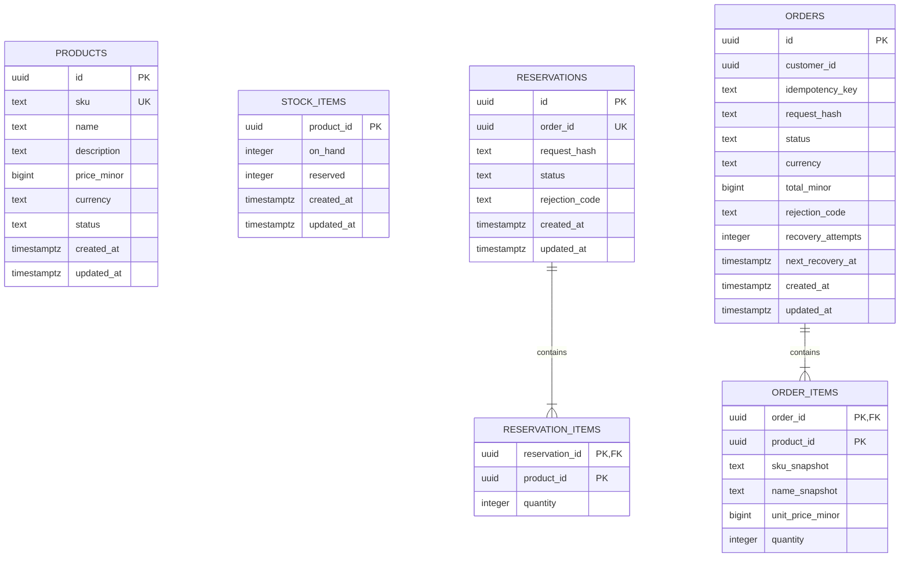

# Milestone 01 Database Design

Scope: Milestone 01 only. This document contains the logical schema, relationships, constraints, and index design for the accepted commerce flow. Implementation remains pending authorization.

Related: [Milestone plan](Milestone-01.md), [Domain model](Domain-Model-01.md), [Database operations](Database-Operations-01.md), and [Database ownership ADR](ADR/003-service-database-ownership.md).

## Shared conventions

- Application-generated UUID identifiers; timestamps are PostgreSQL `timestamptz` and serialized as UTC ISO 8601.
- Identifiers, foreign-key columns, state values, and required business fields are non-null unless explicitly marked optional.
- Use checked text values for states rather than PostgreSQL enums initially, making state evolution an explicit migration exercise later.
- Quantities use bounded integers. Money uses nonnegative `bigint` minor units, with USD prices capped at 100,000,000 cents per unit; enforce input and database bounds.
- `created_at` is immutable. `updated_at` is updated by the owning application in the same transaction as changes.
- Financial snapshots and order lines are immutable after order acceptance. No cross-database cascading deletion.
- Each database includes its own TypeORM migration-history table. Seed data is not mixed into schema history.
- Product SKU shape, money-string representation, request normalization, and error codes are defined in the [API contracts](API-Contracts-01.md).

`products` belongs to Product; `stock_items`, `reservations`, and `reservation_items` belong to Inventory; `orders` and `order_items` belong to Order. Similar product/order identifiers between databases are API references, not foreign keys. The diagram intentionally has no relationship lines spanning databases.

## Product database

| Table | Fields and rules | Indexes / operations |
| --- | --- | --- |
| `products` | `id`; canonical uppercase `sku` (1–64 characters, unique); `name` (1–200); optional `description` (up to 2,000); `price_minor`; `currency = USD`; `status = ACTIVE or ARCHIVED`; timestamps | PK `id`; unique `sku`; `(status, created_at, id)` for deterministic catalog pagination |

Product creation and updates validate price bounds. SKU is immutable and never reused in this milestone. Price/name updates affect future accepted orders; existing orders retain their snapshots. Delete means archive. An archive racing with an order does not revoke a product snapshot already accepted by Order; stronger cross-service coordination is outside this milestone.

## Inventory database

| Table | Fields and rules | Indexes / operations |
| --- | --- | --- |
| `stock_items` | `product_id`; `on_hand` and `reserved` in 0–1,000,000,000; `reserved <= on_hand`; timestamps | PK `product_id`; direct lookups by requested product IDs |
| `reservations` | `id`; unique `order_id`; canonical request hash; `status = RESERVED or REJECTED`; optional rejection code; timestamps | PK `id`; unique `order_id` for durable reservation idempotency |
| `reservation_items` | Composite PK `(reservation_id, product_id)`; positive bounded `quantity`; FK to reservation | Parent FK supports cascade only when deleting isolated test fixtures; ordinary runtime never deletes reservation history |

Available stock equals `on_hand - reserved`. A successful reservation increases `reserved` while keeping `on_hand` unchanged. A rejected reservation records all requested lines and its decision without changing any stock row.

There is deliberately no stock-item FK from reservation lines: an unknown stock item must be representable in a persisted rejection. The service enforces that every successful line has a stock row. Product and stock records are not physically deleted during this milestone.

Invariant: for each product, `reserved` equals the sum of quantities in `RESERVED` reservations. This aggregate invariant is enforced by service transactions and verified by reconciliation tests; a normal row check cannot express it across tables.

Reservation rejection codes are `STOCK_NOT_REGISTERED` and `INSUFFICIENT_STOCK`; a rejected decision requires one, while a successful decision has none. Missing stock takes precedence over insufficient stock when both conditions occur in a request. Enforce valid state/code combinations with local database checks.

## Order database

| Table | Fields and rules | Indexes / operations |
| --- | --- | --- |
| `orders` | `id`; `customer_id` from verified identity; key (1–128 printable ASCII characters); canonical request hash; `status = PENDING, CONFIRMED, or REJECTED`; `currency = USD`; `total_minor`; optional rejection code; nonnegative recovery count; optional next recovery time; timestamps | PK `id`; unique `(customer_id, idempotency_key)`; `(customer_id, created_at, id)` for own-order pagination; partial `(next_recovery_at, id)` for pending recovery |
| `order_items` | Composite PK `(order_id, product_id)`; FK to order; SKU/name snapshots; bounded `unit_price_minor`; positive bounded `quantity` | PK also supports parent order detail lookup |

Line totals are derived from snapshot price × quantity. The order total is calculated by Order using integer arithmetic and saved with lines in one transaction. Verify that it equals the sum of line totals; it is not a cross-row database check. The maximum permitted cart bounds fit PostgreSQL bigint; serialize all money values as strings.

`customer_id` references a verified development token subject. There is no customer table, password store, shipping address, payment record, or future AI schema in this design.

Initial orders are pending with recovery count zero and a non-null next recovery time. Terminal updates clear the next recovery time. Rejected orders require one of Inventory's rejection codes; pending/confirmed orders have none. Validate these local state/field combinations in database checks. Bound `total_minor` to 0–200,000,000,000 cents, consistent with the maximum line count, unit price, and quantity.
